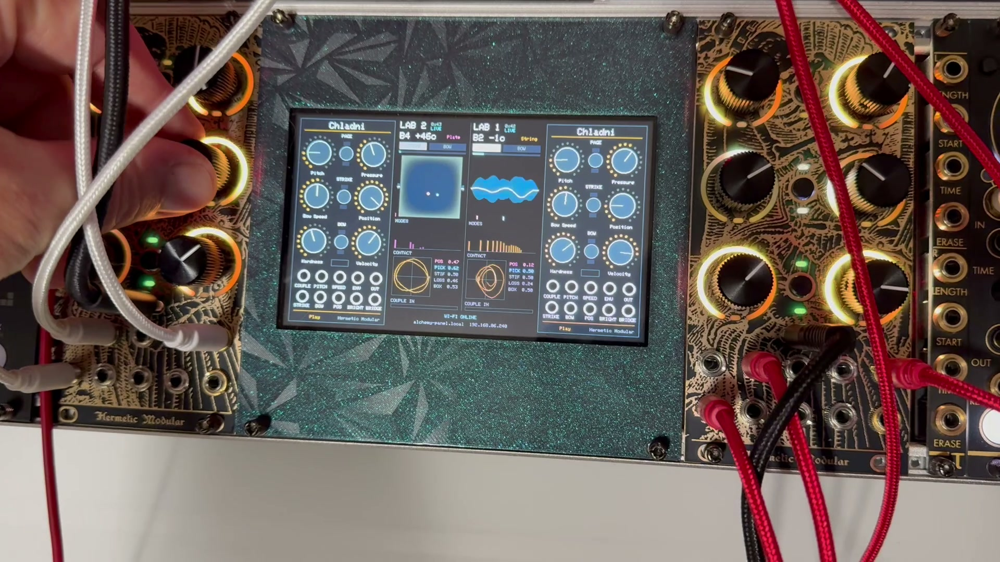

# Chladni — a struck and bowed modal body for two Alchemy Labs



*Chladni in the rack: Lab 2 on the left, Lab 1 on the right, and between
them the Waveshare 5" screen in a printed faceplate. Lab 2 is a plate and
Lab 1 a string; the string is in full swing inside the band of its whole
motion, its mode bars are lit, and both Labs' contact points trace their
phase-portrait loops.*

Firmware for two [Hermetic Modular Alchemy Lab](https://hermeticmodular.com/modules/alchemy-lab)
Eurorack modules and a Waveshare ESP32-S3 5" touch screen. Each Lab is one
physical instrument: a **mallet** and a **bow** acting at one point on a body
of 24 vibrating modes, which can be a **string**, a **bar** or a **plate**.
Patch each Lab's BRIDGE into the other's COUPLE and they become two
instruments on one soundboard: strike one and the other answers on the
partials they share. The screen shows each body moving in slow motion, the
sand figure a plate would draw, the energy in every mode, and the bow's
state, live.

```
      Lab 2 (I2C 0x43)                          Lab 1 (I2C 0x42)
   J10 BRIDGE ──────── patch cable ────────► J1 COUPLE
   J1  COUPLE ◄─────── patch cable ───────── J10 BRIDGE
   J9  OUT ──► mixer                 mixer ◄── J9 OUT
         │                                        │
         │ B3/B5 (I2C4, 100 kHz)                  │
         └─────────► Waveshare ESP32-S3 5" ◄──────┘
                     I2C controller, polls both Labs
```

## How it works

**The exciter and the body are solved together, with no delay.** Each mode
is a zero-delay-feedback state-variable filter, and such a filter's
response to *this* sample's input is a known linear term. So the velocity
and displacement at the contact point are `v = v_free + Y·F` and
`y = y_free + D·F`, with `Y` and `D` fixed whenever the modes are built.
That turns the friction law and the contact law into scalar equations in
the force `F`, solved every sample by a bracketed Newton iteration. This is
what lets a bow lock into real Helmholtz motion and a mallet bounce the way
it would. Splitting the exciter and the body across two Labs through an
audio cable cannot do it: the round trip through two codecs and two audio
blocks is several milliseconds, so the bow would always be answering the
string as it was a while ago.

- **Mallet:** Hunt–Crossley contact, `F = k·δᵖ·(1 + λ·δ̇)`, with the
  mallet's own mass. Hardness sets the contact time, from 4 ms (felt) to
  0.15 ms (steel).
- **Bow:** Coulomb friction with a Stribeck drop from static to sliding,
  regularised through zero. Pressure is scaled by Schelleng's maximum bow
  force, so one setting stays playable at any bow position, speed or pitch.
  Clean bowing holds from about a third to two thirds of the Pressure knob.
- **Clean attacks.** Left to itself, a friction-curve bow spends 100–300 ms
  slipping twice a period before Helmholtz motion forms, which is heard as
  a scratch at every note. So at each onset (the bow landing, or reversing)
  the string is given the ideal Helmholtz shape for the new direction,
  blended in over 3 ms, and the bow force bites 50 % harder for the first
  80 ms. Gated notes then mostly settle within 15–60 ms, and slurs
  instantly.
- **Bodies:** a string (`fₙ = n·f₀·√(1 + B·n²)`), a free–free bar
  (1 : 2.76 : 5.40 …), or a slightly rectangular simply supported plate,
  whose near-degenerate mode pairs beat. Modes near Nyquist are dropped.
- **Box:** the bridge signal through thirteen violin-family body
  resonances, scalable from violin to cello size.
- **Coupling that cannot howl.** The cable loop between two Labs is delayed
  and its gain is whatever the patch makes it, so its stability comes from
  the small-gain theorem: each Lab caps its own gain from COUPLE in to
  BRIDGE out at 0.85 of its most resonant point. The loop through both is
  then below 1 whatever the other Lab does and whatever the delay. A
  struck Lab rings the other at unison or a fifth to within 2–3 dB; a
  minor third away the other stays silent, because they share no partials.

The sound engine (`src/chladni/chladni_dsp.*`) has no libDaisy dependency,
so the same source builds natively and renders to WAV: see
[Hearing it without hardware](#hearing-it-without-hardware).

## Hardware

- 2 × Hermetic Modular Alchemy Lab, **board v2** (Daisy Seed2 DFM)
- Waveshare **ESP32-S3-Touch-LCD-5** (the 800×480 model; the 5B is
  1024×600 and needs the board config changed)
- An I2C breakout to join the bus lines, with one pair of pull-ups (the
  pictured bench uses a Serial Wombat PCB0012)
- Two patch cables for the coupling, and one or two for the outputs

### Wiring the I2C bus

**Hermetic Modular's hardware documentation is the authority on the
expansion header.** Read these sections before you wire anything:

- [Expansion header](https://hermeticmodular.com/docs/hardware#expansion-header): the pinout and the headline warnings
- [Pins and alternate functions](https://hermeticmodular.com/docs/hardware#pins-and-alternate-functions): what each pin can do
- [Power and return paths](https://hermeticmodular.com/docs/hardware#power-and-return-paths): the rails you must never join
- [Connecting two Alchemy Labs](https://hermeticmodular.com/docs/hardware#connecting-two-alchemy-labs) and [I2C between two Labs](https://hermeticmodular.com/docs/hardware#i2c-between-two-labs)
- [Two external pull-ups are required](https://hermeticmodular.com/docs/hardware#two-external-pull-ups-are-required)
- [Electrical limits and bring-up](https://hermeticmodular.com/docs/hardware#electrical-limits-and-bring-up): 3.3 V logic, level shifting, cables

Chladni uses the same pins, bus (I2C4) and speed (100 kHz) as their guide.
The difference is that **the ESP32 panel is the controller** and **both
Labs are targets**, at 0x42 and 0x43.

| Signal | Each Alchemy Lab expansion header | Waveshare panel (screw terminal on the back) |
| --- | --- | --- |
| SCL | **B3**, header pin 8 (PB6, I2C4 SCL) | `SCL` |
| SDA | **B5**, header pin 7 (PB7, I2C4 SDA) | `SDA` |
| GND | header pin 5 (any of 2, 5, 12–14, 16–19) | `GND` |
| pull-up supply | — | `VOUT` (3.3 V with jumper H8 at its default) to the breakout's pull-up Vcc |

The panel's terminal reads, left to right on the silkscreen: `VIN GND VOUT
GND SDA SCL CAN_L CAN_H 485_B 485_A DO0 DO1 DI_COM GND DI0 DI1`.

- **Pin 1 of the Lab header is −12 V and pin 11 is +12 V.** Seen from the
  back, pin 1 is at the marked end of the upper row, which runs 1 to 10.
  Check the harness sits on pins 5, 7 and 8 before powering up.
- **Wire only SDA, SCL and ground.** Never a straight-through ribbon, and
  never join pin 15 (3V3A) between Labs.
- **Leave B7 and B8 (pins 10 and 20) alone.** They are the Lab's own I2C1,
  which carries its GPIO expander and CV DAC.
- **One pair of pull-ups** for the whole bus, to the panel's 3.3 V `VOUT`.
  The panel board has its own level shifter and 4.7 kΩ pull-ups on its side;
  the Labs add none.
- **The panel's own touch controller and IO expander share this bus**
  (0x5D, 0x20–0x27, 0x30–0x3F), which is why the whole bus runs at 100 kHz.
- **Swapped SDA/SCL fails silently:** every address NACKs and nothing else
  looks wrong. Label the wires by the Lab's B3/B5.

### Power and handling

- In the rack, power the panel from **+12 V on `VIN`** (it takes 7–36 V).
- **Don't power it from `VIN` and a computer's USB at once:** the board
  puts its VIN-derived 5 V onto the USB-C VBUS pin.
- **Power everything together, and change cables only with power off**
  ([Expansion header](https://hermeticmodular.com/docs/hardware#expansion-header)).

### Patching

| From | To | Why |
| --- | --- | --- |
| Lab 1 **J10 BRIDGE** | Lab 2 **J1 COUPLE** | Lab 1's bridge shakes Lab 2 |
| Lab 2 **J10 BRIDGE** | Lab 1 **J1 COUPLE** | and back |
| each Lab's **J9 OUT** | the mixer | Lab 1 and Lab 2 make a stereo pair |

Turn **Couple** up on the Body page of both Labs to hear them answer each
other. With Couple at zero, or no cables, each Lab is a solo instrument.

## The instrument

### Buttons

| Button | Does |
| --- | --- |
| **B1** | next page: Play, Body, Box |
| **B2** | strike, at the Velocity knob; flashes white |
| **B3** | the bow: hold it to bow while held, tap it to leave the bow down, tap again to lift |

**B3's light is the bow's state:** green for a clean tone (Helmholtz
motion, one slip per period), amber when it slips too often (too light, or
still finding the note), red when it is pressed too hard. A dim green means
the bow is down but not speaking yet.

### Knobs

| Page | Knob | |
| --- | --- | --- |
| **Play** | Pitch | 27.5 Hz to 1.76 kHz; PITCH adds 1 V/oct |
| | Pressure | bow pressure; clean from about a third to two thirds |
| | Bow Speed | bipolar; the sign is the bow's direction |
| | Position | where the bow and mallet touch: the end (bright) to the middle (hollow) |
| | Hardness | mallet, felt to steel |
| | Velocity | how hard B2 strikes |
| **Body** | Material | String, Bar or Plate |
| | Stiffness | stretches the partials sharp, towards metal; keep low to bow a string |
| | Decay | ring time of the fundamental, 50 ms to 20 s |
| | High Loss | extra loss for the upper partials; bowing likes it high |
| | Pickup | where the dry output listens |
| | Couple | how strongly COUPLE shakes this body; capped, so it never howls |
| **Box** | Box | the dry pickup to the bridge heard through a wooden box |
| | Box Size | violin to cello |
| | Rosin | the grain of bow hair and a player's unsteady hand |
| | Level | output level |

**To bow a string:** Material String, Stiffness near zero, High Loss high,
Pressure around the middle, Bow Speed about halfway either side, Position
near the end. Box up and Box Size high for a cello.

### Jacks

| Jack | | |
| --- | --- | --- |
| J1 | COUPLE | audio in: the other Lab's BRIDGE |
| J2 | STRIKE | trigger; its height is the velocity (4 V is full) |
| J3 | PITCH | 1 V/oct |
| J4 | BOW | over 0.3 V puts the bow down, and the voltage scales Pressure: a 5 V gate bows at the knob's pressure, an envelope swells it |
| J5 | SPEED | adds to Bow Speed, ±5 V is full |
| J6 | POS | adds to Position |
| J7 | ENV | output: the envelope, 0–8 V |
| J8 | BRIGHT | output: the spectral centroid, in octaves above the fundamental, 1 V each |
| J9 | OUT | the instrument |
| J10 | BRIDGE | to the other Lab's COUPLE |

## The screen

Lab 2 is on the left and Lab 1 on the right, as they sit in the rack. Each
Lab's knob panel is on the outside, with labels read off the module, and
on the inside is a column showing:

- **the note** and how many cents off it is, and the material;
- **STRIKE**, which flashes on each strike, and **BOW**, the bow's state
  (CLEAN, SLIP or HARD) as on B3; under them the envelope;
- **the body.** A string or bar is drawn moving in slow motion, about one
  turn of the fundamental a second, inside a faint band of its whole swing.
  A clean bowed string shows the single travelling corner of Helmholtz
  motion. A plate shows a **Chladni figure**: sand on the nodal lines of its
  strongest overtone together with that mode's mirror partner, so it draws
  the curved figures Chladni drew, and morphs as the balance between them
  shifts. (A struck plate rings too many modes at once for one still
  pattern, and its fundamental has no nodal lines inside the plate.) Pink
  marks the strike point, cyan the pickup;
- **MODES:** 24 bars, each at its mode's real frequency on a log axis, its
  energy in dB;
- **CONTACT:** the contact point's phase portrait, velocity against
  displacement over one cycle. Clean bowing draws a closed loop; a strike
  spirals;
- **COUPLE IN:** how hard the other Lab's bridge is shaking this one.

The pictures are rebuilt on the panel from each mode's amplitude and phase,
sent about seven times a second; the slow-motion strobe is animated on the
panel between updates.

## Building and flashing the firmware

### Toolchain

- `git`, `make`, `dfu-util`, Python 3
- [Arm GNU Toolchain](https://developer.arm.com/downloads/-/arm-gnu-toolchain-downloads)
  (`arm-none-eabi-gcc`)

### Build

```sh
git clone --recursive https://github.com/etotman/alchemy-lab-chladni.git
cd alchemy-lab-chladni
make libdaisy                      # once: builds lib/libDaisy

make PANEL_I2C_ADDR=0x42           # Lab 1
cp build/chladni.bin chladni_0x42.bin
make PANEL_I2C_ADDR=0x43           # Lab 2
cp build/chladni.bin chladni_0x43.bin
```

`--recursive` matters: libDaisy has submodules of its own. On an existing
clone, run `git submodule update --init --recursive`. The build tree is
wiped whenever the address changes, so the two builds never share objects.

### Flash

Each Lab needs the binary built for its address.

**Web programmer.** The easiest way: load the `.bin` at
[hermeticmodular.com/program](https://hermeticmodular.com/program).

**Over USB with dfu-util.** The Lab must be powered in the rack, with its
front USB-C connected. The running firmware can reboot itself into the
Daisy bootloader, which appears only briefly, so start dfu-util waiting
**first** ([Bootloader and update mode](https://hermeticmodular.com/docs/hardware#bootloader-and-update-mode)):

```sh
dfu-util -w -a 0 -s 0x90040000:leave -D chladni_0x42.bin -d ,0483:df11 &
sleep 0.5
python3 tools/hostlink_reboot.py reboot /dev/cu.usbmodemXXXXXXXX   # that Lab's port
wait
python3 tools/hostlink_reboot.py hello  /dev/cu.usbmodemXXXXXXXX   # expect: Chladni 0.1.1
```

- Flash one Lab at a time: dfu-util takes whichever bootloader appears.
- Close any web-programmer tab first; the browser holds the serial port.
- "Invalid DFU suffix signature" is a harmless warning.

### Checking the build without hardware

`tools/descriptor_probe/run.sh chladni` renders the control descriptor the
module will report to the web editor, natively, and fails if the module
would report no controls. That failure is the one that makes the web
programmer hang at "reconnect and verify firmware" after a perfectly good
flash: every HostLink firmware must `presets.Manage()` at least one
component (here, the Pager). The probe compiles a mirror of the firmware's
controls in `tools/descriptor_probe/mirrors/chladni.cpp`; update it when
you add or rename a control.

### Hearing it without hardware

```sh
tools/chladni_render/run.sh            # every scene and check
tools/chladni_render/run.sh modbow     # one scene
```

This builds the engine natively and writes WAVs to
`tools/chladni_render/out/`: strikes on each material, bow pressure sweeps,
gated and slurred bowing (with each note's settle time printed), two Labs
coupled through a 3.5 ms cable loop, and the stability and stress checks.
See its [README](tools/chladni_render/README.md).

## Building the panel

The sketch is in `panel/chladni5/`. It needs the Arduino ESP32 core
**3.3.x** (3.3.12 tested) and Waveshare's libraries at the versions in
their demo package: **ESP32_Display_Panel 1.0.0**, **ESP32_IO_Expander
1.0.1** and **esp-lib-utils 0.1.2**. The Adafruit GFX core is vendored in
`src/gfx/`.

```sh
arduino-cli compile \
  --fqbn esp32:esp32:esp32s3:PSRAM=opi,FlashSize=16M,PartitionScheme=app3M_fat9M_16MB,CDCOnBoot=cdc \
  panel/chladni5
```

- **The first flash is over USB.** The USB-C port is the ESP32-S3's native
  USB (`CDCOnBoot=cdc`); upload with `arduino-cli upload -p <port>` and the
  same FQBN.
- **After that, update over Wi-Fi.** Copy `wifi_secrets.example.h` to
  `wifi_secrets.h` (git-ignored) with your network, then
  `panel/ota_push.sh chladni5 [address]` builds and pushes the image to the
  panel's web server. A new image that can't get back on Wi-Fi within 90 s
  rolls back to the previous one by itself.
  `http://alchemy-panel.local/status` prints the bus link, rates and each
  Lab's state.
- **Never use Arduino `Wire`.** Waveshare's IO-expander library uses
  ESP-IDF's legacy I2C driver, and the two abort at boot if both are linked.
  The sketch polls the Labs with `driver/i2c.h` on the bus the board
  already installed.
- **No flash writes while it runs:** each one scrambles the picture for its
  duration on this core.
- `esp_panel_board_custom_conf.h` is set for the 800×480 board; the touch
  and expander I2C clocks must be equal (100 kHz here), or the board fails
  to start without a message.
- **The bus is polled from its own task** on the second core. Each 32-byte
  read blocks for about 3 ms at 100 kHz, and polling between drawing steps
  starved the bus once the strobe animated.

## Wire format

Each Lab is an I2C target running `src/common/panel_i2c`, which answers
every 32-byte read with `[n] [n stream bytes] [padding]`. The stream is
framed `AA 55 type len payload crc8`, and carries the module's knob labels,
knob positions and page alongside these firmware EVENTs (type `0x14`, up
to 8 bytes each):

| Event | Payload | When |
| --- | --- | --- |
| `0x50` STAT | flags, Hz × 16 (2 bytes), envelope, slips per period × 32, couple-in level, loudest mode's level | every other control frame |
| `0x51` MODES | chunk \| seq ≪ 3, then three × (amplitude, phase) | eight chunks make one snapshot of all 24 modes |
| `0x52` GEOM | material, position, pickup, stiffness, box, box size, high loss | when they change, and once a second |

Mode amplitudes are `255 + 60·log10(A / A_max)`. Phases are each mode's
phase minus `n` times the fundamental's, so a periodic motion's shape
stands still and the panel can strobe it. `src/chladni/chladni.cpp` is the
authority. The panel recomputes the mode shapes and frequency ratios from
the same formulas as `chladni_dsp.cpp`, so a change to either has to be
made in both.

## Layout

```
├── src/
│   ├── chladni/         the firmware (chladni.cpp) and the engine (chladni_dsp.*, no libDaisy)
│   └── common/          panel_i2c: the I2C4 target link to the panel
├── panel/
│   ├── chladni5/        the ESP32-S3 panel sketch
│   └── ota_push.sh      build and push a panel update over Wi-Fi
├── tools/
│   ├── chladni_render/       render the engine to WAV, with checks
│   ├── descriptor_probe/     check the controls the module will report
│   └── hostlink_reboot.py    read a Lab's firmware version, reboot it to DFU
├── lib/
│   ├── alchemy-sdk/     Hermetic Modular's Alchemy SDK   (submodule)
│   └── libDaisy/        Electrosmith's libDaisy          (submodule)
└── Makefile             from Hermetic Modular's alchemy-template
```

## Credits and license

MIT, see [LICENSE](LICENSE).

Hardware reference: Hermetic Modular's
[Alchemy Lab hardware documentation](https://hermeticmodular.com/docs/hardware).

Built on Hermetic Modular's
[alchemy-template](https://github.com/hermetic-modular/alchemy-template) and
[Alchemy SDK](https://github.com/hermetic-modular/alchemy-sdk), and
Electrosmith's [libDaisy](https://github.com/electro-smith/libDaisy), all MIT
licensed. The panel uses Waveshare's and Espressif's ESP32_Display_Panel
libraries and Adafruit's GFX core.

The physics leans on Hunt and Crossley's contact model, Schelleng's bow-force
limits, Guettler's work on bowed-string attacks, and Woodhouse's
friction-curve bowed-string models.
